<<<<<<< HEAD
# ADRC_WWTP
=======
# ADRC_WWTP

**Active disturbance rejection control for dissolved oxygen regulation in the activated sludge stage of a wastewater treatment plant**

MSc thesis, Master's in Engineering – Industrial Automation, Universidad Nacional de Colombia, Bogotá, 2026.

- Author: Manuel Esteban Peña Choachi
- Director: Ph.D. John Alexander Cortés Romero
- Co-director: M.Sc. Harvey David Rojas Cala

This repository holds the code, processed data, PLC function blocks and LaTeX source of the thesis.
The thesis itself (in Spanish) is [`Latex/Tesis/main.pdf`](Latex/Tesis/main.pdf).

The case study is the dissolved oxygen (DO) loop of the activated sludge tanks of the Tunja WWTP
(Colombia). The plant was identified from 22 months of SCADA data. On that model, an error-based ADRC
with an extended state observer (ESO) and a generalized proportional-integral (GPI) controller were
designed; for this process they are the same loop written in two ways. The work covers saturation,
reference conditioning, noise, dead time and the discrete-time realization. It ends with a library of
IEC 61131-3 function blocks for a ctrlX PLC (Bosch Rexroth, CODESYS-based), tested in the PLC against
a plant model and compared in simulation with an ISA PID of the same robustness.

---

## Contents

1. [Repository structure](#1-repository-structure)
2. [Process and control loop](#2-process-and-control-loop)
3. [Plant model and identification](#3-plant-model-and-identification)
4. [Error-based ADRC with extended state observer](#4-error-based-adrc-with-extended-state-observer)
5. [GPI control](#5-gpi-control)
6. [Practical implementation aspects](#6-practical-implementation-aspects)
7. [PLC implementation](#7-plc-implementation)
8. [Comparison with an ISA PID](#8-comparison-with-an-isa-pid)
9. [Reproducing the results](#9-reproducing-the-results)
10. [Data not included](#10-data-not-included)
11. [References and citation](#11-references-and-citation)

---

## 1. Repository structure

```
.
├── Datos/                     plant data: conversion, identification and processed results
│   ├── tools/                 converter for the SCADA historian (.hst/.hsz -> CSV)
│   ├── analisis/              identification notebook, Python modules and processed CSV files
│   └── txtCtrl/               ctrlX PLC traces of the first closed-loop tests (ADRC and GPI)
├── Documentos/                thesis proposal and the author's working notes (PDF)
├── Latex/Tesis/               LaTeX source of the thesis, its figures and the compiled PDF
├── P&ID/                      P&ID of the aeration stage (Visio and PDF) and drawing guides
├── PLC_ST/                    PLC implementation in structured text (IEC 61131-3)
│   ├── Codigos/               the 7 function blocks (.st)
│   ├── Libreria_ADRC/         the same blocks with the ctrlX library documentation (reST + images)
│   ├── Library_platform/      ctrlX PLC Engineering projects: the ADRC library and an example project
│   └── capturas_codesys/      CFC screenshots, library installation steps and PLC traces (Pruebas/)
├── Simulaciones/PTAR/
│   ├── 01 Datos/              ctrlX PLC traces at 50 ms from the test on module M1
│   └── 02 Diseño/
│       ├── Python/            design and simulation notebooks (continuous and discrete time)
│       └── Matlab/            Simulink models of the ADRC and the GPI with saturation
├── docs/img/                  images used in this README
└── requirements.txt           Python packages used by the notebooks
```

| Path | Content |
|---|---|
| [`Datos/tools/`](Datos/tools/) | `hst2csv.py` and `hstlib.py`: reader for the proprietary binary format of the InduSoft historian (`.hst`, and `.hsz` with LZW compression), obtained by reverse engineering and verified byte by byte on 1,773 days. No dependencies. See its own [README](Datos/tools/README.md). |
| [`Datos/analisis/`](Datos/analisis/) | `analisis_dinamica_limpio.ipynb`: identification and characterization notebook (chapter 2 of the thesis). Modules: `datos.py` (loading and cleaning), `identificacion.py` (windowed ARX and free-run validation), `ensayos.py`, `actuador.py`, `hidraulica.py`, `regimenes.py`, `cruce.py`. The CSV files are processed results (ARX windows, clean steps, daily regimes) and the signals read by the design notebooks. |
| [`Datos/txtCtrl/`](Datos/txtCtrl/) | Traces exported from ctrlX PLC of the ADRC and GPI in closed loop with a simulated plant. |
| [`Documentos/`](Documentos/) | Thesis proposal, the bibliography spreadsheet and the author's notes 00–05 (equations of the plant, ADRC theory, digital ADRC on a DC motor, ADRC on the ASM model). |
| [`Latex/Tesis/`](Latex/Tesis/) | `main.tex`, `secciones/` (one file per chapter), `figuras/`, `references.bib` and `main.pdf`. Its [README](Latex/Tesis/README.md) (Spanish) tells which notebook cell produces each figure and number. |
| [`P&ID/`](P%26ID/) | `P&ID.vsdx` (Visio) and `P&ID.pdf`, used as Figure 2.1 of the thesis; `Guias/`: ISA-5.1 drawing guides. |
| [`PLC_ST/Codigos/`](PLC_ST/Codigos/) | `ADRC_ESO`, `GPI`, `ADRC_GPI`, `PREFILTER_ADRC`, `PREFILTER_GPI`, `BEZIER_REF` and `PLANT` (section 7). |
| [`PLC_ST/Libreria_ADRC/`](PLC_ST/Libreria_ADRC/) | Same code with the documentation shown by the ctrlX Library Manager; `_Images/` has the equations, block diagrams and CFC wiring of each block. |
| [`PLC_ST/Library_platform/`](PLC_ST/Library_platform/) | `Library/ADRC.library` and `ADRC.compiled-library` (the ADRC library) and `Example/ADRC_Module.project`. |
| [`PLC_ST/capturas_codesys/`](PLC_ST/capturas_codesys/) | CFC screenshots of each loop (offline and online), `instalacion_libreria/` and `Pruebas/` (PLC traces of the BEZIER_REF and PREFILTER_ADRC tests). |
| [`Simulaciones/PTAR/01 Datos/`](Simulaciones/PTAR/01%20Datos/) | ctrlX traces at 50 ms of the test on module M1 (dead time and sensor noise). |
| [`Simulaciones/PTAR/02 Diseño/Python/`](Simulaciones/PTAR/02%20Dise%C3%B1o/Python/) | `ADRC_PTAR_continuo.ipynb`: model, ADRC and GPI design, anti-windup, reference conditioning, PLC traces and PID comparison (chapters 3 to 6). `ADRC_PTAR_discreto.ipynb`: discretization of the controllers and discrete-time simulations. |
| [`Simulaciones/PTAR/02 Diseño/Matlab/`](Simulaciones/PTAR/02%20Dise%C3%B1o/Matlab/) | Simulink models of the ADRC and the GPI with saturation, and a live script. |

---

## 2. Process and control loop

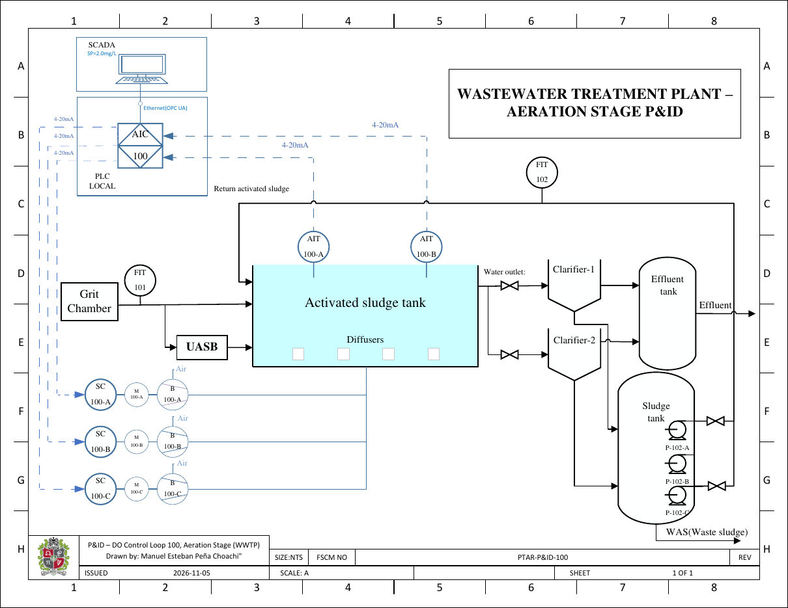

The plant has three identical aeration modules (M1, M2 and M3). In each one, the water from the grit
chamber (FIT-101) reaches the activated sludge tank directly and through the UASB reactor; it leaves
to the clarifiers, and part of the sludge returns to the tank (RAS, FIT-102, pumps P-102-A/B).

Loop 100 is the dissolved oxygen loop, the one studied here:

| Tag | Element |
|---|---|
| AIT-100-A, AIT-100-B | DO transmitters at the inlet and outlet of the tank, 4–20 mA to the PLC |
| AIC-100 | Controller in the local PLC: averages the two measurements and computes the command $u$ (0–100 %) |
| AR-100 | SCADA: records the DO and sends the setpoint to the PLC over Ethernet (OPC UA) |
| SC-100-A/B/C | Variable frequency drives of the blower motors (4–20 mA) |
| B-100-A/B/C | Blowers; the air goes to the diffusers at the bottom of the tank |

The operating setpoint is 2.0 mg/L. The plant was operated with a single 0–100 % command split between
two blowers: the first 50 % took one blower to its maximum and the other 50 % drove the second one.
The data show that with one blower the DO barely moves, and that it rises quickly when the second one
starts. For that reason both blowers are connected to the same 0–100 % command, without splitting it.

---

## 3. Plant model and identification

The oxygen mass balance of the tank, with $K_{La} = k_\alpha u$, is affine in the input:

```math
\dot S_O(t) = f\big(S_O, t\big) + g\big(S_O, t\big)\,u(t), \qquad g = k_\alpha\left(S_O^{*} - S_O\right)
```

It is nonlinear, because the input gain depends on the oxygen itself. Instead of solving that
nonlinearity, the ADRC approach is used: everything that differs from a pure integrator goes into a
total disturbance $\bar\xi$, and only a constant input gain $b_0$ is kept. In practice $b_0$ comes
from a first-order plus dead-time model identified from the data:

```math
G(s) = \frac{Y(s)}{U(s)} = \frac{k_{dc}}{\tau s + 1}\,e^{-\theta s}
\quad\Longrightarrow\quad
\dot y(t) = \bar\xi(t) + b_0\,u(t), \qquad \bar\xi(t) \leftarrow -\frac{y(t)}{\tau}, \qquad b_0 = \frac{k_{dc}}{\tau}
```

**Data.** 22 months of the SCADA historian, converted with `Datos/tools`. The 0–100 % command sent
to the drives was not historized, so the electric power of the aeration panel, as a percentage of full
load, is used as the control signal: $u = 100\,P/P_{\max}$.

**Identification.** On the open-loop days, a first-order ARX model with a constant term is fitted by
least squares in 3-hour windows:

```math
y[k+1] = \varphi\,y[k] + \gamma\,u[k] + \delta, \qquad
\tau = -\frac{T_s}{\ln\varphi}, \qquad K = \frac{\gamma}{1-\varphi}, \qquad b_0 = \frac{K}{\tau}
```

The models are validated by free-run simulation. The dead time was measured with a test in the PLC of
module M1, and the sensor noise from PLC traces at 50 ms.

| Quantity | M2 (interquartile range) | M3 (interquartile range) |
|---|---|---|
| $K$ [mg/(L·%)] | 0.0077 – 0.0342 | 0.0212 – 0.109 |
| $\tau$ [min] | 11 – 26 | 15 – 40 |
| $b_0$ [mg/(L·h·%)] | 0.0335 – 0.107 | 0.0816 – 0.224 |

| Design value | |
|---|---|
| Dead time $\theta$ | 0 – 60 s (measured on M1: 39 s and 50 s); design value 50 s |
| Sensor noise, $\sigma$ of the averaged DO at 50 ms | 0.0011 mg/L |
| **Nominal plant** | $k_{dc} = 0.05$ mg/(L·%), $\tau = 20$ min, $\theta = 50$ s |
| **Input gain of the controller** | $b_0 = k_{dc}/\tau = 0.15$ mg/(L·h·%) $= 4.17\times10^{-5}$ mg/(L·s·%) |

One controller tuning must work over all these ranges, for both modules, which is what the ADRC is
meant to do. The dead time is used only to check robustness, not in the design.

---

## 4. Error-based ADRC with extended state observer

The controller works on the tracking error $e_y = y - r$. The plant is written as one integrator
excited by $b_0 u$ plus a total disturbance $\xi$, which also contains the setpoint dynamics, and a
constant (step) model is used for $\xi$ $(n = m = 1)$:

```math
\dot e_y(t) = \xi(t) + b_0\,u(t), \qquad
\mathbf X(t) = \begin{bmatrix} e_y(t) & \xi(t) \end{bmatrix}^{\top}, \qquad
\mathbf A = \begin{bmatrix} 0 & 1 \\ 0 & 0 \end{bmatrix},\;
\mathbf B = \begin{bmatrix} 1 \\ 0 \end{bmatrix},\;
\mathbf C = \begin{bmatrix} 1 & 0 \end{bmatrix}
```

Extended state observer and control law, with $u_0 = b_0 u$:

```math
\dot{\widehat{\mathbf X}}(t) = (\mathbf A - \mathbf L\mathbf C)\,\widehat{\mathbf X}(t) + \mathbf B\,u_0(t) + \mathbf L\,e_y(t),
\qquad
u_0(t) = -\omega_c\,\hat e_y(t) - \hat\xi(t), \qquad u(t) = \frac{u_0(t)}{b_0}
```

With a good estimate the disturbance is cancelled and the error follows $\dot e_y \approx -\omega_c e_y$.
Bandwidth tuning puts the observer poles at $-\omega_o$:

```math
\mathbf L = \begin{bmatrix} 2\,\omega_o \\ \omega_o^2 \end{bmatrix}, \qquad k_p = \omega_c
```

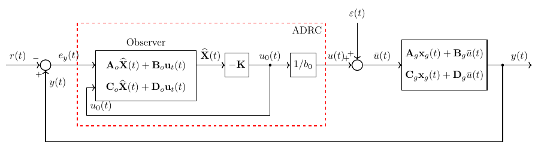

**Tuning used in the thesis.** $\omega_c = 4/\tau = 3.33\times10^{-3}$ rad/s (12 rad/h), four times
faster than the open-loop plant, and $\omega_o = 5\,\omega_c = 1.67\times10^{-2}$ rad/s (60 rad/h),
inside the usual range of 3 to 10 times $\omega_c$. A larger $\omega_o$ rejects the disturbance better,
but lets more sensor noise into the blower command and loses phase margin with dead time. With
$\theta = 50$ s the phase margin of this tuning is already 36°, which limits how fast $\omega_c$ can
be. The robustness was checked over the interquartile ranges of $k_{dc}$, $\tau$ and $\theta$.

---

## 5. GPI control

### 5.1 Control law

The GPI controller is built only from integrals of the error and of the control signal (flat
filtering): the error is reconstructed from integrals instead of being observed. For $n = m = 1$ it
is a PI with an extra filter pole:

```math
b_0\,C(s) = \frac{u_0(s)}{-e_y(s)} = \frac{k_1 s + k_0}{s\,(s + k_2)}, \qquad
\left(s^3 + k_2 s^2 + k_1 s + k_0\right) e_y(s) = s\,(s + k_2)\,\xi(s)
```

The gains $k_2$, $k_1$ and $k_0$ are the coefficients of the characteristic polynomial, so they set
both the tracking dynamics and the disturbance rejection. The loop is stable if $k_0, k_1, k_2 > 0$
and $k_2 k_1 > k_0$ (Routh–Hurwitz). The GPI can be tuned as a PI with a filter, with $k_1/b_0$ as the
proportional gain, $k_0/b_0$ as the integral gain and $k_2$ as the filter pole, or with the ADRC
approach of section 5.2.

### 5.2 Equivalence with the ESO

Placing the poles at $-\omega_c$ and $-\omega_o$ (double) gives exactly the transfer function of the
error-based ADRC with ESO:

```math
k_2 = \omega_c + 2\,\omega_o, \qquad k_1 = 2\,\omega_c\,\omega_o + \omega_o^2, \qquad k_0 = \omega_c\,\omega_o^2
\quad\Longrightarrow\quad
\Delta(s) = s^3 + k_2 s^2 + k_1 s + k_0 = (s + \omega_c)(s + \omega_o)^2
```

The thesis shows that this equivalence holds in continuous time, in discrete time and also with
saturation (section 5.3). Setpoint step from 2.0 to 2.2 mg/L and an input disturbance of −15 % at
40 min, with the nominal plant, without dead time or saturation: the two responses coincide.

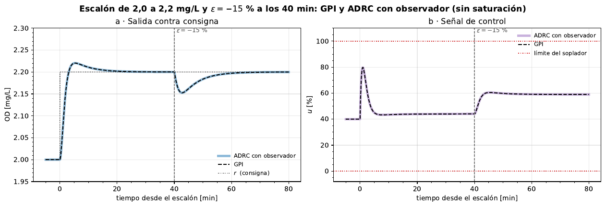

### 5.3 Saturation scheme (anti-windup)

Any linear controller can be written as $u = \frac{P(s)}{L(s)}\,(-e_y)$, with $L(s)$ monic of
degree $n$. It can be implemented by feeding back the saturated command through a stable monic
polynomial $E_1(s)$ of the same degree (The Control Handbook, sec. 19.1.3):

```math
v(s) = \frac{P(s)}{E_1(s)}\,\big(-e_y(s)\big) - \frac{L(s) - E_1(s)}{E_1(s)}\,u_{\mathrm{sat}}(s),
\qquad u_{\mathrm{sat}}(t) = \operatorname{sat}\big(v(t)\big)
```

When the actuator does not saturate, $v = u_{\mathrm{sat}} = u$ and the original controller comes
back:

```math
u(s)\left[1 + \frac{L(s) - E_1(s)}{E_1(s)}\right] = \frac{P(s)}{E_1(s)}\,\big(-e_y(s)\big)
\quad\Longrightarrow\quad
u(s) = \frac{P(s)}{L(s)}\,\big(-e_y(s)\big)
```

For the GPI, $P(s) = k_1 s + k_0$ and $L(s) = s\,(s + k_2)$, and $1/b_0$ goes right after
$P/E_1$, as in the ADRC ($u = u_0/b_0$). The feedback branch receives the applied command
$u_{\mathrm{sat}}$, not the requested one:

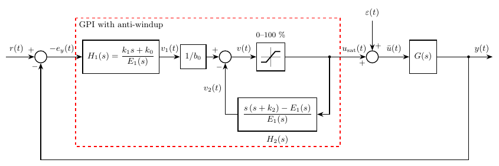

$E_1$ is free, as long as it is stable and of degree 2. Two choices were implemented:

- **With the gains**, $E_1(s) = s^2 + k_2 s + k_1$ (block `GPI`): $\Delta(s)$ without its constant
  term, divided by $s$. It needs no factorization, and it is stable whenever $k_1, k_2 > 0$.

```math
v_1(s) = \frac{k_1 s + k_0}{s^2 + k_2 s + k_1}\,\big(-e_y(s)\big), \qquad
v_2(s) = \frac{-k_1}{s^2 + k_2 s + k_1}\,u_{\mathrm{sat}}(s), \qquad
v(s) = \frac{v_1(s)}{b_0} - v_2(s)
```

- **With the observer polynomial**, $E_1(s) = (s + \omega_o)^2$ (block `ADRC_GPI`): the observer
  part of $\Delta(s) = (s + \omega_c)(s + \omega_o)^2$.

```math
v_1(s) = \frac{\omega_o\big[(\omega_o + 2\omega_c)\,s + \omega_c\,\omega_o\big]}{(s + \omega_o)^2}\,\big(-e_y(s)\big), \qquad
v_2(s) = \frac{\omega_c\,s - \omega_o^2}{(s + \omega_o)^2}\,u_{\mathrm{sat}}(s), \qquad
v(s) = \frac{v_1(s)}{b_0} - v_2(s)
```

In both cases the static gain of the inner feedback is exactly $-1$, so the integral action is
recovered. With $E_1 = (s + \omega_o)^2$ the GPI with anti-windup is exactly the ADRC whose observer
is fed with $b_0\,u_{\mathrm{sat}}$; with $E_1 = s^2 + k_2 s + k_1$ the difference only shows while
the actuator is saturated.

The same scheme in Simulink (`Simulaciones/PTAR/02 Diseño/Matlab/`):

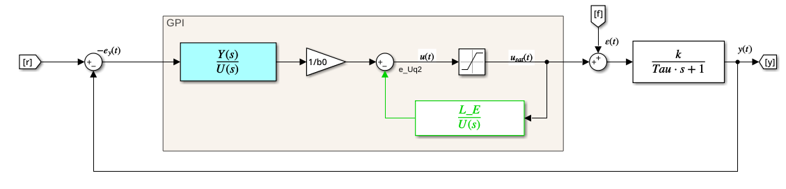

Start-up from 0 mg/L with the nominal plant and the blower limited to 0–100 %: the ADRC with observer
and the GPI with both choices of $E_1$ reach the setpoint without overshoot, while the GPI without
anti-windup winds up and overshoots to about 2.8 mg/L. Under the same saturation, the GPI with
anti-windup also stays stable over the plant variations and with a dead time of 100 s, twice the
design value.

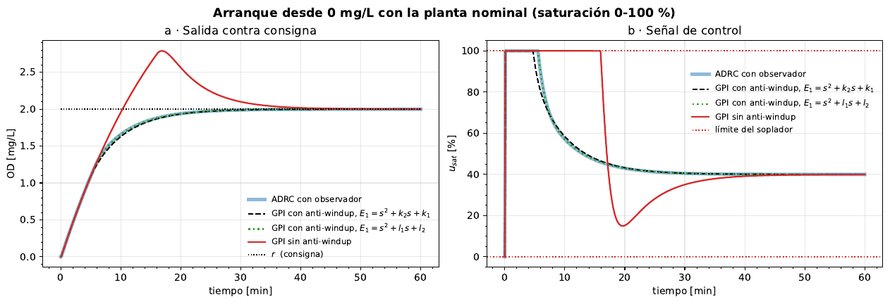

---

## 6. Practical implementation aspects

### 6.1 Saturation of the ADRC

The observer of the ESO receives the applied command $b_0\,u_{\mathrm{sat}}$, not the requested one
(Simulink model below). That alone gives the ADRC its anti-windup: the observer sees the command that
really reaches the plant, so its states do not wind up while the blower is at 0 or 100 %. The GPI
uses the scheme of section 5.3.

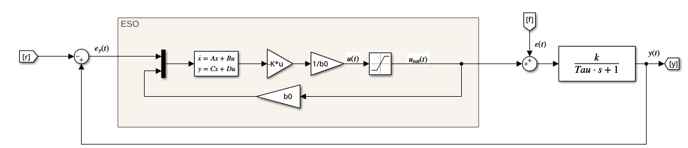

### 6.2 Reference conditioning

On a setpoint step the error-based ADRC overshoots even though all its poles are real. With the design
model the setpoint response is

```math
\frac{y(s)}{r(s)} = \frac{k_1 s + k_0}{s^3 + k_2 s^2 + k_1 s + k_0} = \frac{k_1 s + k_0}{(s + \omega_c)(s + \omega_o)^2}
```

It has a zero at $s = -k_0/k_1 = -\omega_c\,\omega_o/(\omega_o + 2\omega_c) = -\tfrac{5}{7}\,\omega_c$,
slower than the pole $-\omega_c$, and that zero causes the overshoot. Besides, a step in the setpoint
asks for a very large control peak. Both are reduced by conditioning the reference before it enters
the loop, with a prefilter or with a Bézier curve. In both cases the controller does not change, and
neither does the disturbance rejection.

#### Setpoint prefilter

Following the prefilter in the reference channel proposed by Herbst and Madoński (sec. 6.4.2), a
first-order filter with its pole exactly on that zero is placed before the summing junction:

```math
F(s) = \frac{r_f(s)}{r(s)} = \frac{k_0}{k_1 s + k_0} = \frac{1}{\dfrac{k_1}{k_0}\,s + 1}
= \frac{1}{\dfrac{\omega_o + 2\,\omega_c}{\omega_c\,\omega_o}\,s + 1}
```

Its static gain is 1, so the output still reaches the setpoint, and its time constant is
$k_1/k_0 = 420$ s (7 min). The prefilter is outside the loop: the controller still receives only the
error, now $e_y = y - r_f$.

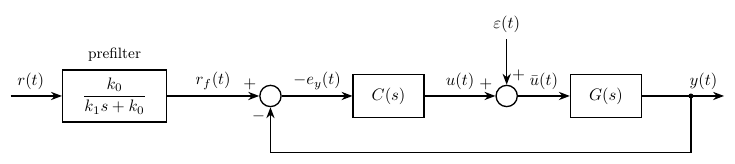

The pole of the filter cancels the zero, and the three design poles remain, with no zero. The
disturbance does not go through the prefilter, so its response is the same:

```math
\frac{y(s)}{r(s)} = \frac{k_0}{(s + \omega_c)(s + \omega_o)^2}, \qquad
\frac{y(s)}{\bar\xi(s)} = \frac{s\,(s + k_2)}{(s + \omega_c)(s + \omega_o)^2}
```

Setpoint step from 2.0 to 2.2 mg/L and an input disturbance of −15 % at 40 min, with the nominal
plant and the blower limited to 0–100 %:

| | Overshoot | Peak of $u$ | Settling time (2 %) |
|---|---|---|---|
| Without prefilter, $\theta = 0$ | 10.3 % | 80 % | 15.7 min |
| With prefilter, $\theta = 0$ | 0 % | 50 % | 24.4 min |
| Without prefilter, $\theta = 50$ s | 46 % | 93 % | 14.7 min |
| With prefilter, $\theta = 50$ s | 0 % | 54 % | 24.7 min |

The disturbance gives the same dip with and without the prefilter. The price is a slower arrival at
the setpoint.

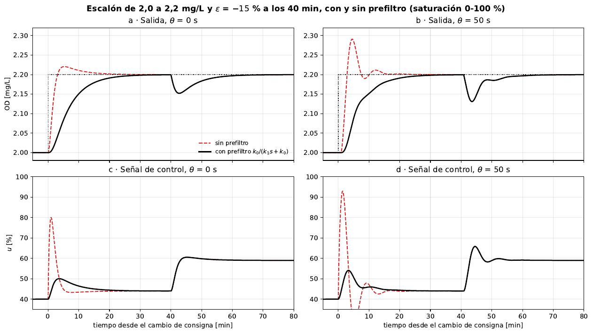

In the PLC, `PREFILTER_ADRC` receives $\omega_c$ and $\omega_o$, and `PREFILTER_GPI` receives $k_0$
and $k_1$; both are discretized with Tustin (section 7). If the structure of the controller changes
(another plant order, or ramp references), the filter has to be re-tuned so that its poles cancel the
new zeros of $y/r$.

#### Cubic Bézier reference

At each setpoint change, a cubic segment goes from the current value and slope of the reference to
the new setpoint, with zero final slope, in a chosen time $t_f$:

```math
y^*(\tau) = y_c + \tau\big(c_1 + \tau\,(c_2 + \tau\,c_3)\big), \qquad \tau = \frac{t - t_0}{t_f} \in [0, 1]
```

```math
\bar\Delta = r - y_c, \qquad c_1 = \dot y_c\,t_f, \qquad c_2 = 3\bar\Delta - 2\,\dot y_c\,t_f, \qquad c_3 = -2\bar\Delta + \dot y_c\,t_f
```

so that $y^*(0) = y_c$, $\dot y^*(0) = \dot y_c$, $y^*(1) = r$ and $\dot y^*(1) = 0$. Because it
restarts from the state of the reference, a new setpoint can arrive in the middle of a segment. Unlike
the prefilter, the zero stays in the loop, so a small overshoot can remain.

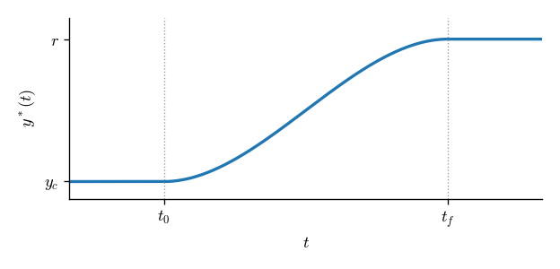

### 6.3 Noise

The ADRC with ESO and the GPI share the same strictly proper transfer function, so they already filter
high-frequency sensor noise without extra filters. To pass less noise to the blower command,
$\omega_o$ is lowered.

### 6.4 Discretization

- **ESO.** The observer keeps its structure; the integrators of the augmented system are discretized
  with zero-order hold, and the gains are computed from the images of the poles,
  $z_c = e^{-\omega_c T_s}$ and $z_o = e^{-\omega_o T_s}$.
- **GPI and prefilter.** Tustin, block by block, implemented in direct form I.
- **Sampling.** At least 10 times, and preferably 20 times, faster than the fastest pole, the
  observer's. The PLC uses $T_s = 50$ ms.

### 6.5 Dead time

If $\theta$ is known, the observer can be synchronized with the plant by delaying the command that
enters it by $n_d \approx \theta/T_s$ samples. The other way is to keep $\omega_c$ low enough to have
phase margin, and to smooth the reference.

---

## 7. PLC implementation

The blocks are written in structured text (IEC 61131-3) in ctrlX PLC Engineering (ctrlX WORKS, Bosch
Rexroth, based on CODESYS) and wired in CFC. The realizations only use sums, gains and one-sample
delays, so they can be written in any IEC 61131-3 language; in ST the delays are updated at the end of
the cycle, oldest first.

### Blocks

| Block | Inputs | Output | What it does |
|---|---|---|---|
| `ADRC_ESO` | `SET_POINT`, `ACTUAL`, `WC`, `WO`, `B0`, `TS`, `U_MIN`, `U_MAX`, `RESET` | `U` | Error-based ADRC with discrete ESO, tuned with bandwidths |
| `GPI` | `SET_POINT`, `ACTUAL`, `K0`, `K1`, `K2`, `B0`, `TS`, `U_MIN`, `U_MAX`, `RESET` | `U` | GPI with gains and anti-windup, $E_1 = s^2 + k_2 s + k_1$; keeps the old gains if $k_2 k_1 \le k_0$ |
| `ADRC_GPI` | `SET_POINT`, `ACTUAL`, `WC`, `WO`, `B0`, `TS`, `U_MIN`, `U_MAX`, `RESET` | `U` | The same GPI computed from the bandwidths, $E_1 = (s + \omega_o)^2$: equivalent to `ADRC_ESO` |
| `PREFILTER_ADRC` | `SET_POINT`, `ACTUAL`, `WC`, `WO`, `TS`, `RESET` | `Y` | Setpoint prefilter tuned with $\omega_c$ and $\omega_o$ |
| `PREFILTER_GPI` | `SET_POINT`, `ACTUAL`, `K0`, `K1`, `TS`, `RESET` | `Y` | Setpoint prefilter tuned with $k_0$ and $k_1$ |
| `BEZIER_REF` | `SET_POINT`, `ACTUAL`, `TF`, `TS`, `RESET` | `Y` | Cubic Bézier reference, replanned at each setpoint change |
| `PLANT` | `U`, `K_DC`, `TAU`, `TS` | `Y` | First-order plant (Tustin) to test the blocks without the process |

All inputs are `LREAL` except `TS` and `TF` (`TIME`) and `RESET` (`BOOL`). The defaults are
`TS := T#50MS`, `U_MIN := 0`, `U_MAX := 100` and `TF := T#20M`.

### State machine

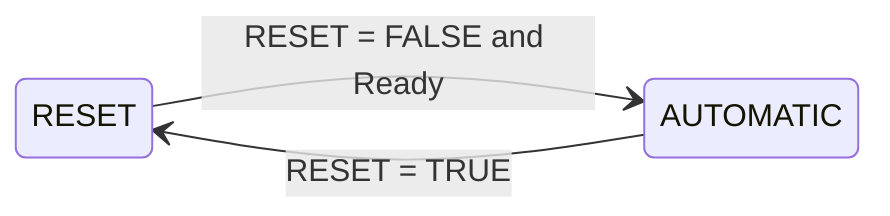

- **RESET** works like the reset of an industrial PID. The controllers set `U` to 0 within
  `[U_MIN, U_MAX]` and clear their states; in `ADRC_ESO` the observer starts at
  $\hat{\mathbf x} = [0,\ -b_0 U]$. The prefilters and `BEZIER_REF` follow `ACTUAL`, so leaving
  RESET starts the reference from the measurement.
- **Gains are only computed in RESET.** A change of `WC`, `WO`, `B0`, `K0..K2` or `TS` takes effect
  after the next RESET; `BEZIER_REF` reads `TF` at each setpoint change. The block leaves RESET when
  it has valid parameters (`Ready`), for example `TS > 0`, `WC > 0`, `WO > WC` and `B0 > 0` in
  `ADRC_ESO`.
- **AUTOMATIC** executes the block every cycle.
- `TS` must be equal to the period of the task that calls the block. A dedicated task for the
  controller is recommended, and the measurement must be updated faster than the controller runs.
- The error is computed inside the block from `SET_POINT` and `ACTUAL`, and `U` is already limited.

### Discrete equations

**`ADRC_ESO`** (executed every $T_s$):

```math
z_c = e^{-\omega_c T_s}, \quad z_o = e^{-\omega_o T_s}, \quad
k_{p,d} = \frac{1 - z_c}{T_s}, \quad
l_{1,d} = 2\,(1 - z_o), \quad l_{2,d} = \frac{(1 - z_o)^2}{T_s}
```

```math
\begin{aligned}
\hat x_1[k] &= (1 - l_{1,d})\,\hat x_1[k-1] + T_s\,\hat x_2[k-1] + T_s\,b_0\,u_{\mathrm{sat}}[k-1] + l_{1,d}\,e_y[k-1] \\
\hat x_2[k] &= -\,l_{2,d}\,\hat x_1[k-1] + \hat x_2[k-1] + l_{2,d}\,e_y[k-1] \\
u_{\mathrm{sat}}[k] &= \operatorname{sat}_{u_{\min}}^{u_{\max}}\!\left(-\frac{k_{p,d}\,\hat x_1[k] + \hat x_2[k]}{b_0}\right)
\end{aligned}
```

**`GPI` and `ADRC_GPI`** (Tustin, direct form I). Both filters share the denominator:

```math
H_1(z) = \frac{\beta_0 + \beta_1 z^{-1} + \beta_2 z^{-2}}{1 + \alpha_1 z^{-1} + \alpha_2 z^{-2}}, \qquad
H_2(z) = \frac{\bar\gamma_0 + \bar\gamma_1 z^{-1} + \bar\gamma_2 z^{-2}}{1 + \alpha_1 z^{-1} + \alpha_2 z^{-2}}
```

The direct term $\bar\gamma_0$ of $H_2$ closes an algebraic loop through the saturation; the block
solves it by computing $w$ with the past samples and then $u = \operatorname{sat}\big(w/(1 + \bar\gamma_0)\big)$.

<details>
<summary>Coefficients of <code>GPI</code>, with E<sub>1</sub>(s) = s² + k<sub>2</sub>s + k<sub>1</sub></summary>

```math
D_0 = 4 + 2k_2 T_s + k_1 T_s^2, \quad \alpha_1 = \frac{2k_1 T_s^2 - 8}{D_0}, \quad \alpha_2 = \frac{4 - 2k_2 T_s + k_1 T_s^2}{D_0}
```

```math
\beta_0 = \frac{k_0 T_s^2 + 2k_1 T_s}{D_0}, \quad \beta_1 = \frac{2k_0 T_s^2}{D_0}, \quad \beta_2 = \frac{k_0 T_s^2 - 2k_1 T_s}{D_0}, \quad
\bar\gamma_0 = \frac{\bar\gamma_1}{2} = \bar\gamma_2 = -\frac{k_1 T_s^2}{D_0}
```

</details>

<details>
<summary>Coefficients of <code>ADRC_GPI</code>, with E<sub>1</sub>(s) = (s + ω<sub>o</sub>)²</summary>

```math
D_0 = (2 + \omega_o T_s)^2, \quad \alpha_1 = \frac{-2\,(4 - \omega_o^2 T_s^2)}{D_0}, \quad \alpha_2 = \frac{(2 - \omega_o T_s)^2}{D_0}
```

```math
\beta_0 = \frac{\omega_o T_s\,[\omega_c\omega_o T_s + 2(\omega_o + 2\omega_c)]}{D_0}, \quad
\beta_1 = \frac{2\,\omega_c\omega_o^2 T_s^2}{D_0}, \quad
\beta_2 = \frac{\omega_o T_s\,[\omega_c\omega_o T_s - 2(\omega_o + 2\omega_c)]}{D_0}
```

```math
\bar\gamma_0 = \frac{T_s\,(2\omega_c - \omega_o^2 T_s)}{D_0}, \quad
\bar\gamma_1 = \frac{-2\,\omega_o^2 T_s^2}{D_0}, \quad
\bar\gamma_2 = \frac{-T_s\,(2\omega_c + \omega_o^2 T_s)}{D_0}
```

</details>

**`PREFILTER_ADRC` and `PREFILTER_GPI`** (Tustin):

```math
r_f[k] = -\alpha_f\,r_f[k-1] + \beta_f\,\big(r[k] + r[k-1]\big), \qquad
\alpha_f = \frac{k_0 T_s - 2 k_1}{k_0 T_s + 2 k_1}, \qquad
\beta_f = \frac{k_0 T_s}{k_0 T_s + 2 k_1}
```

with $k_1/k_0 = (\omega_o + 2\omega_c)/(\omega_c\omega_o)$ in `PREFILTER_ADRC`.

**`BEZIER_REF`**: the segment of section 6.2 evaluated with $\tau = n\,T_s/t_f$, where $n$ restarts at
each setpoint change, and $y^*[n] = r$ for $\tau \ge 1$.

**`PLANT`** (Tustin):

```math
y[k] = -\alpha_g\,y[k-1] + \beta_g\,\big(u[k] + u[k-1]\big), \qquad
\alpha_g = \frac{T_s - 2\tau}{T_s + 2\tau}, \qquad
\beta_g = \frac{k_{dc}\,T_s}{T_s + 2\tau}
```

### Wiring and use

The reference block feeds `SET_POINT` of the controller, and `PLANT` can replace the process for
tests:

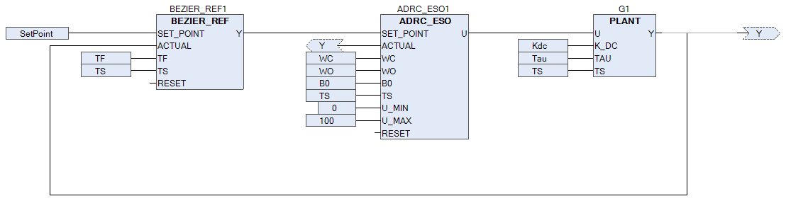

Example with the design plant ($\tau = 1200$ s, $k_{dc} = 0.05$ mg/(L·%)): $\omega_c = 4/\tau = 0.00333$
rad/s, $\omega_o = 5\,\omega_c = 0.0167$ rad/s and $b_0 = k_{dc}/\tau = 4.17\times10^{-5}$ mg/(L·s·%).

```iecst
fbPrefilter(SET_POINT := lrSetPoint, ACTUAL := lrDO, WC := 0.00333, WO := 0.0167,
            TS := T#50MS, RESET := xReset);
fbAdrc(SET_POINT := fbPrefilter.Y, ACTUAL := lrDO, WC := 0.00333, WO := 0.0167,
       B0 := 4.17E-5, TS := T#50MS, RESET := xReset);
lrU := fbAdrc.U;
```

### ctrlX library

The seven blocks are packaged as the library **ADRC**. In `PLC_ST/Libreria_ADRC/` each block carries
its documentation in reStructuredText (description, connection, theory with equations and block
diagram, states and example), written for the ctrlX Library Manager.

To install it in ctrlX PLC Engineering:

1. *Library Repository* → *Install* → select `PLC_ST/Library_platform/Library/ADRC.compiled-library`.
2. In the project, *Library Manager* → *Add library* → ADRC.

The screenshots of each step are in
[`PLC_ST/capturas_codesys/instalacion_libreria/`](PLC_ST/capturas_codesys/instalacion_libreria/).

### Test in the PLC

Each combination of reference block and controller was connected to `PLANT`, configured as the design
plant, with the tuning above and $T_s = 50$ ms. The traces recorded by the PLC (setpoint changes from
0 to 2 mg/L and from 2 to 2.2 mg/L; Bézier with $t_f = 2400$ s and $1200$ s):

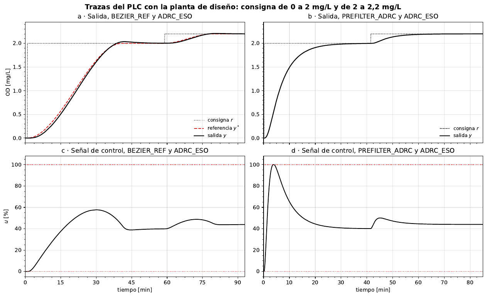

| Loop | Setpoint [mg/L] | Overshoot | Settling time (2 %) | Max. $u$ |
|---|---|---|---|---|
| `BEZIER_REF` + `ADRC_ESO` | 0 → 2 | 1.8 % | 36.3 min | 57.7 % |
| | 2 → 2.2 | 4.4 % | 27.4 min | 48.8 % |
| `PREFILTER_ADRC` + `ADRC_ESO` | 0 → 2 | 0 % | 24.4 min | 100 % |
| | 2 → 2.2 | 0 % | 24.5 min | 50.1 % |

The Bézier reference keeps the command away from saturation on the large step; the prefilter removes
the overshoot. On the small step, the prefilter with the ADRC gives practically the same values as the
discrete-time simulation at $T_s = 50$ ms.

---

## 8. Comparison with an ISA PID

The ADRC was compared in simulation with an ideal ISA PID with a filtered derivative, acting on the
same error:

```math
C_{PID}(s) = K_p\left(1 + \frac{1}{T_i\,s} + \frac{T_d\,s}{1 + \dfrac{T_d}{N}\,s}\right),
\qquad K_p = 66.7\ \%/(\mathrm{mg/L}), \quad T_i = 160.9\ \mathrm{s}, \quad T_d = 40.2\ \mathrm{s}, \quad N = 2
```

$K_p$ gives the same initial control jump as the ADRC on a 0.2 mg/L step (about 40 %), and $T_i$ and
$T_d$ give the same maximum sensitivity $M_s$ without dead time. The dead time of 50 s is used only to
evaluate.

| | $\theta$ | $M_s$ | Phase margin | Gain margin | $\omega_{BW}$ [rad/h] |
|---|---|---|---|---|---|
| ADRC | 0 | 1.202 | 65.8° | ∞ | 56.4 |
| PID | 0 | 1.202 | 50.0° | ∞ | 21.2 |
| ADRC | 50 s | 2.318 | 36.0° | 2.12 | 79.0 |
| PID | 50 s | 1.585 | 37.5° | 7.37 | 23.8 |

With the same robustness and the same initial effort, the PID ends up with a lower bandwidth. On
setpoint steps and on an input disturbance step, the ADRC has lower IAE and ITAE, less overshoot and a
better disturbance rejection. Because the PID is biproper, it also passes much more sensor noise to
the blower command. With the 50 s dead time the ADRC starts to oscillate, while the PID stays slow.

---

## 9. Reproducing the results

**Python.** The notebooks were run with Python 3.12 and the packages in
[`requirements.txt`](requirements.txt):

```bash
python -m venv .venv
source .venv/bin/activate
pip install -r requirements.txt
```

- `Simulaciones/PTAR/02 Diseño/Python/ADRC_PTAR_continuo.ipynb` and `ADRC_PTAR_discreto.ipynb` run
  with the files of this repository. Their paths are relative to the repository root; the first code
  cell finds the root by itself, so they can be opened from their folder.
- `Datos/analisis/analisis_dinamica_limpio.ipynb` needs the raw historian, which is not included
  (section 10). Its processed results are included.
- The notebooks write their figures to `Latex/Tesis/figuras/`.

**Thesis.**

```bash
cd Latex/Tesis
pdflatex main && bibtex main && pdflatex main && pdflatex main
```

**PLC.** Open `PLC_ST/Library_platform/Example/ADRC_Module.project` in ctrlX PLC Engineering, or
install the library (section 7) and copy the blocks of `PLC_ST/Codigos/` into a new project.

**MATLAB.** The Simulink models are in `Simulaciones/PTAR/02 Diseño/Matlab/`.

---

## 10. Data not included

These folders are excluded in [`.gitignore`](.gitignore):

- `Datos/Hst/` (raw SCADA historian, 0.7 GB) and `Datos/csv/` (the same data converted to CSV, about
  7.4 million rows, 0.9 GB; several files are over GitHub's 100 MB limit). The CSV files are
  regenerated from the historian with `Datos/tools/hst2csv.py` (see its README).
- `Datos/analisis/maestra.pkl`: a cache that the analysis rebuilds from the CSV files.
- Service reports, photos and videos of the plant visits.
- Third-party books, papers and slides used as references.

---

## 11. References and citation

Main references of the work (the full list is in [`Latex/Tesis/references.bib`](Latex/Tesis/references.bib)):

- H. Sira-Ramírez, A. Luviano-Juárez, M. Ramírez-Neria and E. W. Zurita-Bustamante, *Active
  Disturbance Rejection Control of Dynamic Systems: A Flatness-Based Approach*, Butterworth-Heinemann, 2017.
- G. Herbst and R. Madoński, *Active Disturbance Rejection Control: From Principles to Practice*,
  Springer, 2025. doi:10.1007/978-3-031-72687-3
- H. D. Rojas and J. Cortés-Romero, "On the equivalence between Generalized Proportional Integral
  Observer and Disturbance Observer," *ISA Transactions*, vol. 133, pp. 397–411, 2023.
- J. Han, "From PID to Active Disturbance Rejection Control," *IEEE Trans. Ind. Electron.*, vol. 56,
  no. 3, pp. 900–906, 2009.
- Z. Gao, "Scaling and bandwidth-parameterization based controller tuning," *Proc. American Control
  Conference*, pp. 4989–4996, 2003.
- IEC 61131-3: Programmable controllers – Part 3: Programming languages, 3rd ed., 2013.

To cite this work:

```bibtex
@mastersthesis{pena2026adrc,
  author = {Peña Choachi, Manuel Esteban},
  title  = {Control con rechazo activo de perturbaciones para la regulación de oxígeno disuelto
            en la etapa de lodos activados de una {PTAR}},
  school = {Universidad Nacional de Colombia},
  address = {Bogotá, Colombia},
  year   = {2026},
  type   = {Tesis de Maestría en Ingeniería -- Automatización Industrial}
}
```
>>>>>>> e26d38e (Thesis code, PLC function blocks, processed data and documentation)
